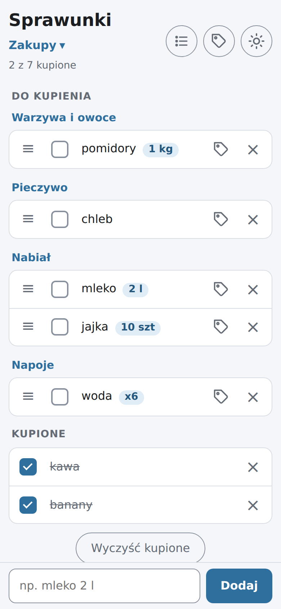
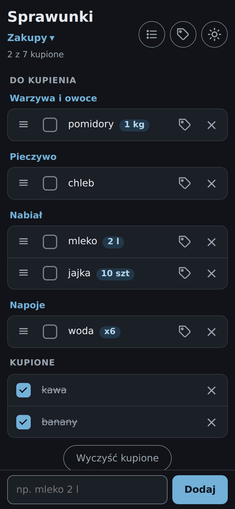
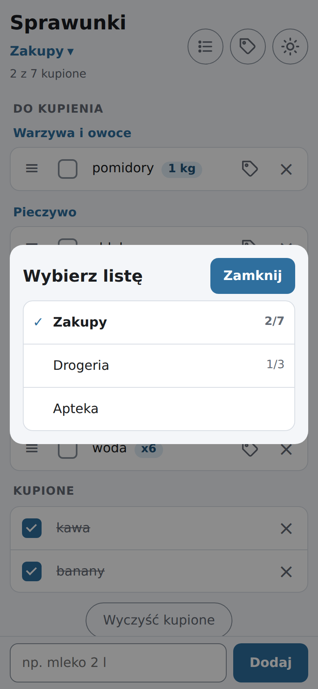
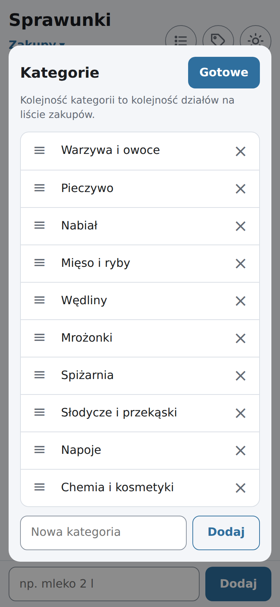

# Sprawunki

Sprawunki to prosta aplikacja webowa (PWA) do prowadzenia listy zakupów: w ciągu dnia dopisujesz produkty, w sklepie odhaczasz kupione, a po zakupach czyścisz listę. Ma być szybsza i prostsza w użyciu niż kartka papieru.

**Aplikacja: https://dawidgorecki.github.io/sprawunki/**

<p>
  
  
  
  
</p>

## Funkcje

- Dodawanie produktów z pola na dole ekranu, w zasięgu kciuka. Ilość wpisujesz w nazwę, np. „mleko 2 l”, „6 jajek” albo „chleb x2”, a aplikacja pokazuje ją jako osobną etykietę.
- Wykrywanie duplikatów bez względu na ilość: ponowne wpisanie produktu, który już jest na liście, nie dodaje go drugi raz. Wpis z nową ilością („mleko 3 l”) ją zmienia, a kupiony produkt wraca do „Do kupienia”.
- Kategorie, czyli działy sklepu: produkty do kupienia są pogrupowane w kolejności, w jakiej chodzisz po sklepie. Aplikacja zna kategorie ok. 200 popularnych produktów, a gdy zmienisz kategorię ręcznie, zapamięta ją na następny raz.
- Własne kategorie: w oknie „Kategorie” dodasz nowe, zmienisz nazwy, usuniesz zbędne i ustawisz kolejność pod swój sklep.
- Osobne listy, np. na spożywczy, drogerię i aptekę. W oknie „Listy” dodasz nowe, zmienisz nazwy, usuniesz zbędne i ustawisz kolejność. Przy kilku listach pod tytułem pojawia się nazwa aktywnej listy: tapnięcie pokazuje wszystkie listy z licznikiem kupionych produktów i przełącza między nimi. Kategorie są wspólne dla wszystkich list.
- Zmiana kolejności produktów w obrębie kategorii: przeciągnij za uchwyt ≡ albo użyj strzałek na klawiaturze.
- Przełącznik w nagłówku, który nie pozwala ekranowi zgasnąć w trakcie zakupów (tam, gdzie przeglądarka to obsługuje).
- Dwie sekcje, „Do kupienia” i „Kupione”, oraz licznik postępu, np. „3 z 8 kupione”.
- Edycja nazwy po tapnięciu, usuwanie jednym przyciskiem i „Wyczyść kupione”.
- „Cofnij” po usunięciu produktu lub wyczyszczeniu kupionych.
- Działanie offline po pierwszym uruchomieniu.
- Tryb jasny i ciemny zgodnie z ustawieniami telefonu, w stonowanej niebieskiej kolorystyce.

## Instalacja na telefonie

- **Android (Chrome):** otwórz link powyżej, a potem ⋮ → „Zainstaluj aplikację”.
- **iOS (Safari 16.4+):** otwórz link, potem „Udostępnij” → „Dodaj do ekranu początkowego”.

Aktualizacje instalują się same: nowa wersja pobiera się w tle i działa od kolejnego uruchomienia.

## Prywatność

Aplikacja nie ma serwera ani kont. Listy są zapisane tylko w pamięci przeglądarki na Twoim urządzeniu (localStorage) i nigdzie nie jest wysyłana. Aplikacja nie korzysta z żadnych zewnętrznych usług ani analityki.

Wyczyszczenie danych przeglądarki lub odinstalowanie aplikacji usuwa listy.

## Dla programistów

Czysty JavaScript (moduły ES), bez frameworków. Do budowania służy [Vite](https://vite.dev/), do testów logiki [Vitest](https://vitest.dev/), a manifest i service worker generuje [vite-plugin-pwa](https://vite-pwa-org.netlify.app/).

Wymagany Node.js 20.19+ lub 22.12+.

```bash
npm install        # instalacja zależności
npm run dev        # serwer deweloperski: http://localhost:5173/sprawunki/
npm test           # testy logiki (Vitest)
npm run test:e2e   # testy interfejsu w przeglądarce (Playwright)
npm run test:e2e:ui  # to samo z podglądem każdego kroku
npm run build      # build do dist/
npm run preview    # podgląd builda (tu działa service worker i tryb offline)
```

Testy interfejsu klikają w prawdziwą aplikację w Chromium, na komputerze i na emulowanym telefonie z ekranem dotykowym. Przed pierwszym uruchomieniem pobierz przeglądarkę: `npx playwright install chromium`. W WSL lub na świeżym Linuksie potrzebne są też biblioteki systemowe: `sudo env "PATH=$PATH" npx playwright install-deps chromium`. Testy interfejsu działają tylko lokalnie, nie w GitHub Actions.

Każdy push na gałąź `main` uruchamia GitHub Actions (`.github/workflows/deploy.yml`). Workflow uruchamia testy, buduje aplikację i publikuje ją na GitHub Pages.

### Struktura

```
index.html         # struktura strony
src/
  main.js          # start aplikacji: wczytanie danych, połączenie logiki z interfejsem
  store.js         # logika listy: czyste funkcje, bez DOM i localStorage
  storage.js       # zapis i odczyt localStorage, migracje, kopia uszkodzonych danych
  ui.js            # renderowanie i obsługa zdarzeń
  manage-dialog.js       # okna zarządzania kategoriami i listami
  list-picker.js         # przycisk z nazwą listy i okno wyboru listy
  list-controls.js       # wspólne dla list: edycja nazwy w miejscu, uchwyt, strzałki
  drag.js          # zmiana kolejności przeciąganiem (Pointer Events)
  wake-lock.js     # blokada wygaszania ekranu (Screen Wake Lock API)
  product-dictionary.js  # słownik produkt → kategoria (same dane)
  styles.css
public/            # favicon i ikony aplikacji
tests/             # testy logiki: store.js i storage.js (Vitest)
e2e/               # testy interfejsu (Playwright)
docs/screenshots/  # zrzuty ekranu do tego pliku
```

Pełna specyfikacja: [SPEC.md](SPEC.md), plan prac: [PLAN.md](PLAN.md).

## Licencja

[Apache License 2.0](LICENSE)
